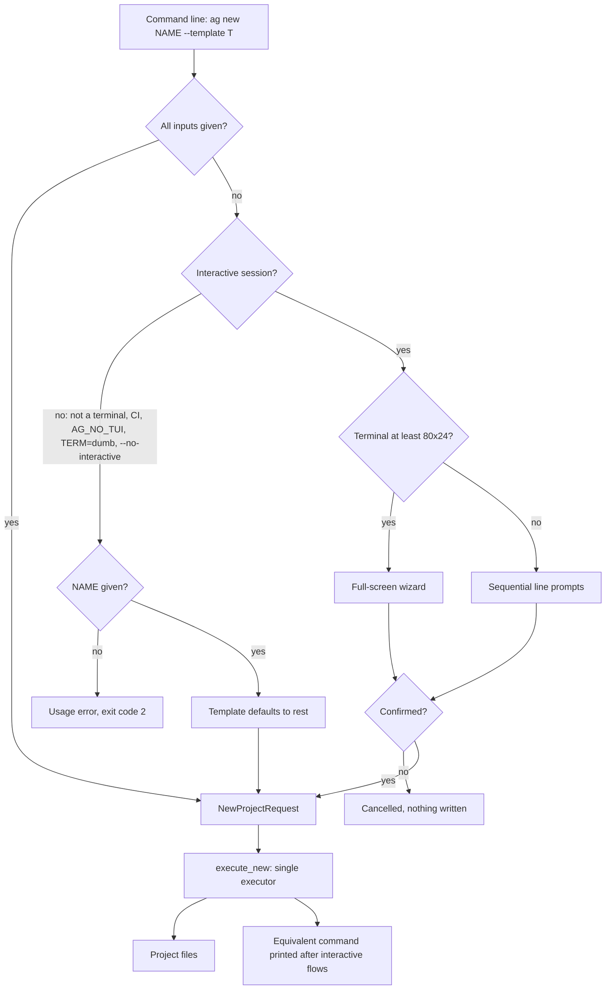
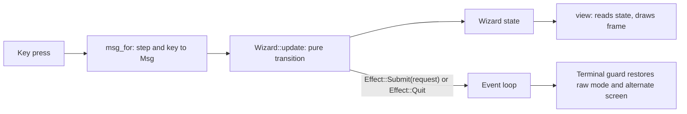
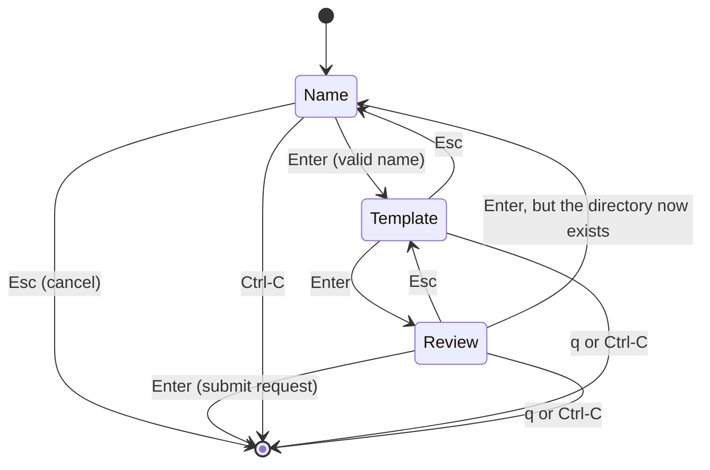

# CLI interactive flow

How the `ag` binary decides between its scriptable path and its interactive
interface, and how both reach the same executor (`RFC-0018`, roadmap Phase
4.7). Last reviewed: 2026-11-10. Source: `crates/ag-cli/src/`.

## Input resolution for `ag new`

The flag parser and the interactive front-ends produce the same
`NewProjectRequest` value. Only `execute_new` writes files.

## Screen architecture

`Wizard::update` and `view` perform no I/O. The event loop in
`crates/ag-cli/src/tui/mod.rs` is the only code that touches the terminal,
and the guard in `tui/terminal.rs` restores it on return, on error, on
`Ctrl-C` and on panic.

## Wizard steps

