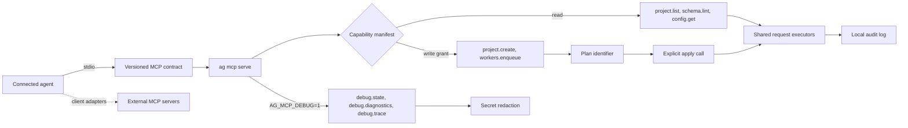
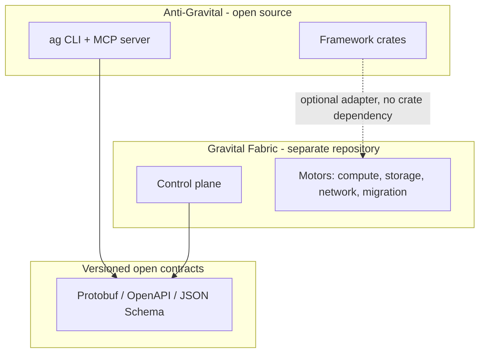

# MCP layer flow

> Diagram for RFC-0024. Last reviewed: 2026-11-21.

## Logical flow

## Boundary with Gravital Fabric

No `ag-*` crate imports a `fabric-*` crate, and no `fabric-*` crate imports an
`ag-*` crate. The arrows that cross the boundary are data contracts, not Rust
dependencies (ADR-0016).
