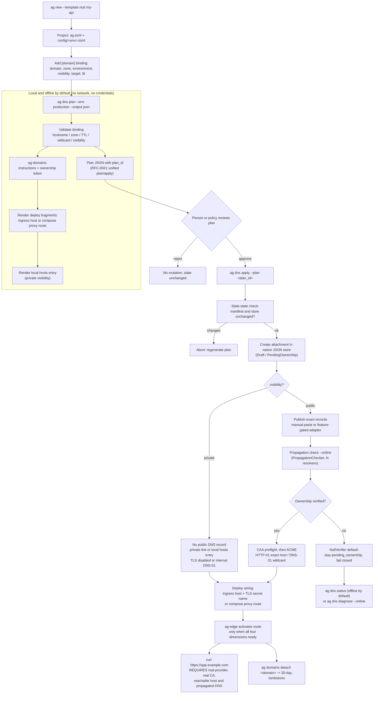

# Domain-to-deploy loop

> Canonical technical document (ADR-0008). Contract source: `RFC-0033`.
> The contract is RFC-0033. `ag dns plan|apply|status` and `ag domains attach`
> are implemented; `TargetKind::Link` remains specified but not implemented.

This document shows how a generated project becomes reachable through a
configured domain, publicly or privately, per environment. It composes existing
building blocks; it does not introduce a new crate or a mandatory service:

- `ag-domains` - attachment state machine, DNS instructions, ownership proof,
  propagation, ACME, CAA preflight and tombstone.
- `ag-edge` - fail-closed hostname routing and SNI selection.
- `deploy/k8s` and `deploy/docker` - optional Ingress and compose packaging.
- `ag.toml` (RFC-0019) and `config/<environment>.toml` (RFC-0020) - the manifest
  and environment configuration.

Rule 12 and ADR-0009 apply: a live DNS provider, a CA and a cluster are
**optional accelerators**. `ag new`, `cargo build`, `cargo test` and `ag dev`
never need them.

## 1. End-to-end flow



Legend: the shaded block and `ag dns status` (without `--online`) run offline
with no credentials. The final `curl` and everything to the right of "Publish
exact records" that touches a network require a real provider and are never
part of a local build or test.

## 2. Worked example (public host)

The following reaches `https://app.example.com` in `production`. Steps 4-11 that
publish records, verify ownership, issue a certificate and resolve the public
name **require a real DNS provider, a real CA and a reachable host**. This is a
documented example, not an executed verification.

### Step 1 - scaffold

```sh
ag new --template rest my-api
cd my-api
cargo build --offline
```

A single-crate project is produced. No domain, provider or cluster is involved.

### Step 2 - declare the binding in `ag.toml`

```toml
[project]
name = "my-api"

[domain]
domain = "app.example.com"
zone = "example.com"
environment = "production"
visibility = "public"
target = { kind = "service", ref = "my-api" }
ttl = 300
tls = "managed_http01"
allow_wildcard = false
```

`visibility` defaults to `private` when omitted, `ttl` to `300`, and a wildcard
host is rejected unless `allow_wildcard = true` with `managed_dns01`. Non-secret
per-environment values may instead live in `config/production.toml`; provider
tokens are only environment variable **names** consumed as `Secret<T>`
(RFC-0020), never file values.

### Step 3 - plan (offline)

```sh
ag dns plan --env production --output json > plan.json
```

The plan contains the binding, validation results, the exact record set
(including the `_ag-domain.app.example.com` ownership TXT token), the ACME mode,
the deploy actions and a `plan_id`. Nothing has been created yet.

### Step 4 - review and apply

```sh
ag dns apply --plan "$(jq -r .plan_id plan.json)"
```

Apply re-computes the plan; if the manifest or the local store changed since
the plan was built, it aborts and asks for a new plan. With the default
`NullVerifier` it creates the attachment as `Draft`/`PendingOwnership` and
refuses to activate it - fail closed. A real verifier is wired explicitly for
the provider path.

### Step 5 - publish DNS records (real provider)

```sh
ag domains instructions app.example.com
```

In native/manual mode the command prints the records to paste at the provider:

```text
Type   Name                              Value
CNAME  app.example.com                   edge.example-cloud.net
TXT    _ag-domain.app.example.com        ag-verification=<token>
```

With a feature-gated DNS adapter and explicit credentials the same records are
applied through `DnsProvider::upsert`. A BIND fragment is available with
`ag domains export-zone`.

### Step 6 - verify ownership (real provider)

```sh
ag domains verify app.example.com
```

`PropagationChecker` confirms the ownership TXT on at least N of the configured
resolvers. Until then `ag dns status` reports `pending_ownership` and no route
is active.

### Step 7 - certificate (real CA)

CAA preflight runs first. For an exact public host `managed_http01` issues a
certificate; a wildcard would require `managed_dns01`. The certificate is
served by `ag-edge` via SNI selection and is never written into the repository.

### Step 8 - render deploy wiring

For Kubernetes, `deplink` renders a fragment into a copied overlay:

```yaml
spec:
  rules:
    - host: app.example.com
      http:
        paths:
          - path: /
            pathType: Prefix
            backend:
              service:
                name: template
                port:
                  name: http
  tls:
    - hosts: ["app.example.com"]
      secretName: app-example-com-tls
```

For Compose it renders a reverse-proxy route: match host `app.example.com`,
terminate TLS at the proxy, forward to `http://my-api:8080`. The segment is
added to a copied compose file; the shipped files keep their loopback port
bindings. The TLS secret is referenced by name only - apply it with the
cluster's own secret mechanism (`deploy/k8s/SECRETS.md`), never from the repo.

### Step 9 - deploy (explicit user action)

```sh
kustomize build deploy/k8s/overlays/api | kubectl apply -f -
kubectl -n anti-gravital rollout status deployment/template
```

The cluster is optional. `ag dns apply` does not run `kubectl` or start a
daemon by default.

### Step 10 - confirm readiness (offline)

```sh
ag dns status --env production
# Lifecycle: active
# Ownership: verified / DNS: routable / TLS: active / Routing: ready
```

Activation requires all four dimensions. Unknown hostnames keep failing closed
at the edge.

### Step 11 - reach the service (requires the real stack)

```sh
curl https://app.example.com
```

This succeeds only when a real provider published the records, they propagated,
a real CA issued the certificate, and the service is deployed behind a reachable
edge or ingress controller. It is deliberately marked as a real-provider step.

## 3. Private host variant

For staging, set `visibility = "private"` and use a link or a local mapping:

```toml
[domain.environments.staging]
domain = "app.staging.example.com"
visibility = "private"
target = { kind = "link", ref = "https://tunnel.internal.example" }
tls = "disabled"
```

No public A/AAAA/CNAME record is emitted. The plan renders a private link and,
optionally, an `/etc/hosts` entry for local development. Public ACME HTTP-01 is
never attempted for a private host; use `disabled` or `managed_dns01` with an
internal CA. The edge still fails closed for any host without an active binding.

## 4. Rollback and safety

- `ag domains detach app.example.com` stops renewal, sets TLS to `Retired` and
  applies a 30-day tombstone that prevents takeover; re-attaching during the
  tombstone is refused. To abandon a plan before apply, simply discard it:
  `ag dns apply` has not written any state until it is called with the plan id.
- In manual mode the operator must delete the provider records; cached DNS may
  linger, but the edge stops serving immediately.
- No credential, certificate or wildcard host is stored in the repository.
- `ag dns status` is offline unless `--online` is passed, so a stdio-only
  interface never performs hidden DNS egress (RFC-0024 prerequisite 7).

## 5. References

- `docs/rfc/RFC-0033-domain-to-deploy-loop.md` - the contract.
- `docs/rfc/RFC-0011-ag-domains-control-plane.md` - attachment lifecycle and
  tombstone.
- `docs/rfc/RFC-0021-server-install-remote-console-and-machine-interface.md` -
  plan/apply and audit.
- `deploy/k8s/README.md`, `deploy/docker/README.md` - optional packaging.
- `templates/CATALOG.md` - template names accepted by `ag new --template`.
